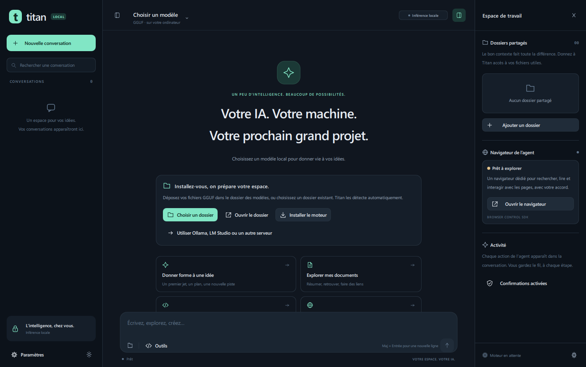

# Titan Local AI

Assistant de bureau Windows x64 en C++20 et Qt Quick 6.8.3. Une interface française pour converser avec un modèle local et lui confier des tâches limitées sur vos fichiers et dans un navigateur dédié.

- Modèles **de texte GGUF** avec `llama.cpp`, détection du dossier, métadonnées et sélection du modèle.
- Services **locaux** compatibles OpenAI : Ollama, LM Studio ou un serveur sur `localhost`, `127.0.0.1` ou `::1`.
- Réponses progressives, Markdown, blocs de code copiables, historique local, arrêt de génération et réflexion lorsque le modèle la prend en charge.
- Agent avec outils de fichiers et Browser Control SDK, aperçu et confirmation des actions par défaut.

Ce projet ne prend pas en charge tous les formats de modèles. Les poids Safetensors/ONNX, la génération d’images, l’audio et l’analyse d’images ne constituent pas des fonctionnalités de cette application. Les capacités de réflexion et d’outils dépendent du modèle et du service utilisés.



## Télécharger et lancer

Téléchargez la [version Windows x64](https://github.com/titanfyre/Titan-Local-AI/releases/latest), extrayez le ZIP puis ouvrez **Launch.bat** ou **TitanLocalAI.exe**. Cette version contient Qt et le runtime Visual C++ : Visual Studio, CMake et Python servent uniquement à compiler les sources. Le runtime [Microsoft Edge WebView2 Evergreen](https://developer.microsoft.com/microsoft-edge/webview2/) est nécessaire pour le navigateur.

## Compiler les sources

Prérequis : Windows 10/11 x64, Visual Studio 2022 ou Build Tools avec **Développement Desktop en C++**, SDK Windows, CMake 3.24+ et Python 3.10+ accessibles dans le terminal. Un GPU compatible Vulkan est facultatif ; la mémoire nécessaire dépend du modèle et du contexte choisis.

Depuis PowerShell, à la racine du dépôt :

```powershell
.\Build.ps1 -Configuration Release -Test -Package
```

`Build.ps1` prépare automatiquement Qt 6.8.3 dans `.deps/`, configure CMake, compile, lance les tests demandés et prépare la distribution. Le premier lancement de la préparation nécessite Internet. Le script d’empaquetage télécharge aussi les archives sources Qt associées aux bibliothèques distribuées, avec vérification SHA-256 et cache local.

L’exécutable compilé est `out/build/Release/TitanLocalAI.exe`. Le dossier et l’archive autonomes sont créés dans `out/packages/`. Double-cliquez sur `Launch.bat` dans le dossier distribué, ou sur `TitanLocalAI.exe`. Pour lancer depuis les sources, le `Launch.bat` à la racine ajoute Qt au chemin du processus.

## Première conversation

1. Dans l’application, **Choisir un dossier** contenant vos modèles de texte `.gguf`, ou **Ouvrir le dossier** pour y déposer un modèle acquis séparément. Aucun poids de modèle n’est fourni ou téléchargé automatiquement. Conservez les fichiers d’un modèle découpé ensemble.
2. Cliquez sur **Installer le moteur**, puis sélectionnez le modèle en haut de la fenêtre. Le moteur intégré utilise les binaires officiels `llama.cpp` **b12167**, vérifiés par SHA-256. Le choix CPU/Vulkan est automatique ; le réglage Couches GPU à `0` force le CPU. Un `llama-server.exe` existant peut aussi être choisi dans les paramètres.
3. Attendez que le moteur soit prêt, puis envoyez votre message. Les paramètres de génération permettent d’ajuster contexte, longueur de réponse, température et réflexion disponible.

Avec Ollama ou LM Studio, démarrez d’abord leur serveur local et chargez un modèle de texte. Dans **Paramètres → Modèles & moteur**, choisissez le fournisseur, vérifiez l’adresse et l’identifiant du modèle, puis cliquez sur **Connecter le fournisseur**. Valeurs habituelles : Ollama `http://127.0.0.1:11434/v1`, LM Studio `http://127.0.0.1:1234/v1`. Les points d’accès distants et les identifiants intégrés à une URL sont refusés. Les modèles Ollama annoncés comme distants sont également refusés ; un service local personnalisé reste responsable de ses propres éventuels relais.

## Fichiers, navigateur et données

**Aucun dossier n’est partagé au premier démarrage.** Ajoutez-en dans l’espace de travail : l’accès initial permet la lecture et la recherche. Activez **Lecture + écriture** uniquement pour les dossiers à modifier. Les écritures de texte sont bornées, atomiques, précédées d’une vérification de la version lue et d’une sauvegarde lorsqu’un fichier existe déjà. L’agent ne dispose pas d’un outil de terminal ou de suppression de fichiers.

Les confirmations des écritures et actions du navigateur sont **activées par défaut**. La boîte de dialogue montre l’action avant votre décision. Vous pouvez les désactiver explicitement dans **Agent & accès**. Les réponses du modèle et les pages consultées ne peuvent pas modifier vos autorisations de dossiers.

**Ouvrir le navigateur** prépare BrowserControl **v0.2.0** à la première utilisation, vérifie son empreinte et ouvre une instance avec son propre profil. Cette installation et la consultation de sites nécessitent Internet. Les outils exposés à l’agent se limitent aux onglets, à la navigation HTTP(S), à l’observation, aux captures et aux interactions encadrées.

Le navigateur nécessite le **runtime Microsoft Edge WebView2 Evergreen** installé sur Windows. Il est distinct du navigateur Microsoft Edge et n’est pas embarqué dans le paquet Titan. Si nécessaire, installez-le depuis le [site Microsoft WebView2](https://developer.microsoft.com/en-us/microsoft-edge/webview2/). La version observée lors de la validation est indiquée dans [VALIDATION.md](docs/VALIDATION.md).

L’inférence du moteur intégré s’effectue sur le PC. Avec un fournisseur local externe, les messages sont transmis à ce service ; sa configuration peut entraîner d’autres communications. Le navigateur accède aux sites visités. Il ne s’agit donc pas d’une promesse d’absence de toute communication réseau.

Réglages, conversations, moteur, profil du navigateur et sauvegardes sont stockés dans le dossier Windows de données locales de l’application, normalement `%LOCALAPPDATA%/titanfyre/TitanLocalAI/`. Les modèles restent dans le dossier choisi. La distribution est portable pour les **binaires** ; les données utilisateur ne sont pas enregistrées à côté de l’exécutable.

Raccourcis : **Ctrl+N** nouvelle conversation, **Ctrl+L** composer, **Ctrl+,** paramètres, **Entrée** envoyer, **Maj+Entrée** nouvelle ligne, **Échap** arrêter la génération.

## Vérification et distribution

```powershell
.\Build.ps1 -Configuration Release -Test
.\scripts\Package.ps1 -Configuration Release
```

Les vérifications sont détaillées dans [docs/VALIDATION.md](docs/VALIDATION.md) : compilation Release, cinq suites CTest, 17 cas d’agent avec fichiers et confirmations, 25 cas de runtime incluant l’inférence CPU/Vulkan, réflexion Qwen3 et outil natif sur deux tours, interface sans avertissement QML et navigateur sur page locale. L’archive a été construite et son application démarrée avec un PATH limité à Windows. Le workflow GitHub reproduit compilation, tests et empaquetage ; son exécution distante et une machine Windows vierge restent à vérifier.

Le paquet contient les DLL Qt et MSVC nécessaires, les notices, les licences et les sources Qt correspondantes. Il ne contient pas vos modèles, conversations, autorisations, caches ni fichiers de tests. Consultez [THIRD_PARTY_NOTICES.md](THIRD_PARTY_NOTICES.md) pour les licences, les sources et le remplacement des bibliothèques Qt. Titan est sous [licence MIT](LICENSE).
